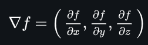
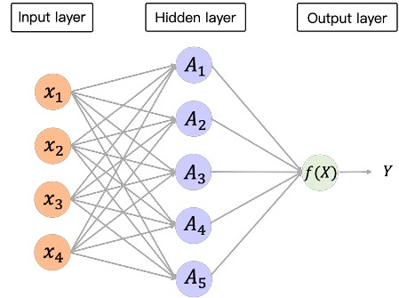

神經網路整個完整的六步驟作用流程如下：

#### 1. 前向傳播 (Forward Pass) 
* **動作**：把輸入的狀態資料 (`states`) 丟進神經網路中。
* **白話文**：讓 AI 根據當前大腦的權重，對盤勢做出預測。
* **程式碼範例**：`predictions = self.q_net(states)`
* 包含線性轉化層(nn.Linear)以及非線性的啟動函數(relu)

#### 2. 計算目標值 (Target Calculation) 
* **動作**：依據強化學習公式 (如貝爾曼方程) ，算出「標準答案應該是多少」。
* **白話文**：對照現實狀況，算出這一步實際上應該要得到什麼分數或機率 (對答案)。
* **程式碼範例**：`targets = rewards + self.gamma * next_q_values * (1.0 - dones)`
* 包含衰減因子(gamma)、獎勵分數以及貝爾曼方程 (Bellman Equation)

#### 3. 計算損失 (Compute Loss) 
* **動作**：把「AI 預測的值」與「計算出來的目標值」交給損失函數。
* **白話文**：計算出一個數值 (Loss) ，代表「離正確答案差多少」。
* **程式碼範例**：`loss = self.criterion(predictions, targets)`
* 包含損失函數 (DQN 模型以及交叉熵 (Cross-Entropy) 損失)

#### 4. 梯度歸零 (Zero Gradients) 
* **動作**：在進行反向傳播前，先清空優化器裡殘留的歷史梯度。
* **白話文**：把計算紙擦乾淨，準備寫上這一輪的新算式，避免舊的梯度干擾新的計算。
* **程式碼範例**：`self.optimizer.zero_grad()`

#### 5. 反向傳播 (Backward Pass / 鏈鎖法則) 
* **動作**：呼叫 `loss.backward()` (啟動 PyTorch 的自動微分引擎)。
* **白話文**：利用微積分的鏈鎖法則 (Chain Rule) ，往回推算神經網路中每一個權重該為這個錯誤負多少責任。
* 計算出神經網路中每一個權重 (Weight) 與偏差 (Bias) 對當前誤差的偏微分 (即梯度 Gradient) 

#### 6. 優化器更新 (Optimizer Step) 
* **動作**：呼叫 `self.optimizer.step()`。
* **白話文**：優化器 (Adam) 根據剛剛算出來的梯度，微調神經網路，讓它下次遇到相同情況時不要再犯一樣的錯。

---

> 註: 梯度公式  
>   
> 註: 權重可以先簡單理解為神經元之間的連結程度  
> 下圖中節點代表神經元，連接線代表權重，神經元又可分為三類: 輸入層/隱藏層/輸出層  
> 
